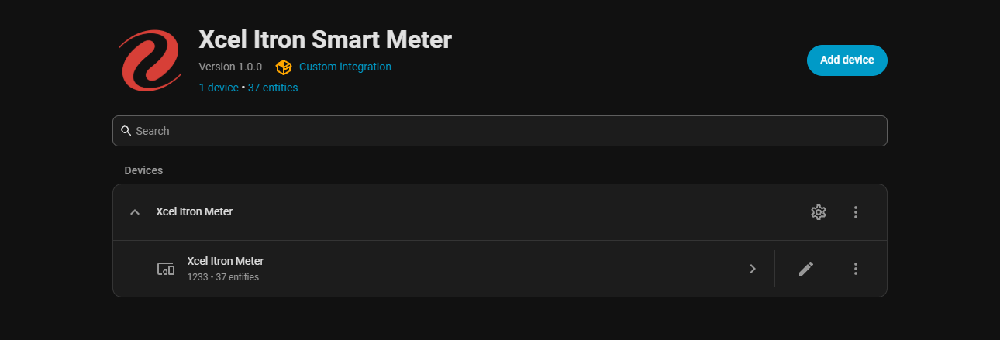

# Xcel Itron Smart Meter for Home Assistant

> **This is an AI-assisted rework of [Zak Nye's (@zaknye) xcel_itron2mqtt](https://github.com/zaknye/xcel_itron2mqtt).**
> The integration, tests and documentation in this repository were largely
> rewritten with AI assistance. All credit for the original concept, the
> IEEE 2030.5 protocol research and the initial implementation belongs to Zak
> Nye. This fork is maintained by [@metel](https://github.com/metel); please
> report issues with this rework here, not upstream.

A native Home Assistant integration for Xcel Energy Itron smart meters. It talks
directly to the meter over your local network using the IEEE 2030.5 REST API and
creates regular Home Assistant sensors - no MQTT broker required.



The upstream project is the `xcel_itron2mqtt` Docker/MQTT bridge. If you are still running the container, see
[Migrating from the MQTT bridge](#migrating-from-the-mqtt-bridge).

## Features

- mDNS discovery for meters that advertise `_smartenergy._tcp.local.`
- Guided setup with automatic TLS client certificate generation
- LFDI displayed in the UI for registration on the Xcel Launchpad
- Optional import of an existing certificate/key pair
- Native sensors with device classes, units and long-term statistics
- Configurable polling interval
- Repair issue when the meter rejects the client certificate
- Firmware-aware endpoint configuration (3.2.39 and 3.2.50)

## Requirements

- Home Assistant 2024.12 or newer
- An Itron meter reachable on your local network
- An [Xcel Launchpad](https://my.xcelenergy.com/MyAccount/s/meters-and-devices/)
  account so you can register the integration's LFDI
- The meter's local IP address and port (port 8081 is typical; discovery fills
  this in automatically when it works)

## Installation

### HACS

1. Open HACS and go to **Integrations**.
2. Open the three-dot menu and choose **Custom repositories**.
3. Add `https://github.com/metel/xcel-itron` with category **Integration**.
4. Install **Xcel Itron Smart Meter** and restart Home Assistant.

> If you previously added another copy of this integration to HACS, remove it
> first so HACS does not see two integrations with the same domain.

### Manual

Copy `custom_components/xcel_itron` into your Home Assistant
`config/custom_components/` directory and restart Home Assistant.

## Setup

1. Go to **Settings -> Devices & Services -> Add Integration** and search for
   **Xcel Itron Smart Meter**.
2. If the meter was discovered automatically, confirm the address. Otherwise
   enter the meter's IP address and port.
3. Choose **Generate a new certificate** (recommended) or
   **Use an existing certificate**.
4. When generating a certificate, copy the displayed **LFDI**.
5. On the Xcel Launchpad, click **Add a Device** and register the LFDI. The
   nickname, manufacturer and device type can be anything you like.
6. Submit the Home Assistant form. The integration retries automatically, so it
   is fine if the meter has not accepted the LFDI yet.

If the meter keeps rejecting the certificate, Home Assistant raises a repair
issue with the LFDI and a link to the Launchpad.

### Using an existing certificate

Choose **Use an existing certificate** and enter the certificate and private key
paths. Relative paths are resolved against your Home Assistant configuration
directory. The certificate must already be registered with Xcel and must use the
Xcel client certificate policy (`1.3.6.1.4.1.40732.2.2`).

## Entities

The integration creates one device for the meter and one sensor per configured
reading. Depending on firmware, this includes:

- Instantaneous Demand
- Current Summation Received / Delivered
- VAh and VARh Received / Delivered
- TOU 0-3 WH Received / Delivered
- Max Demand Received / Delivered
- Power Factor and Power Factor Phase A/B/C
- Time period start timestamps

Cumulative energy sensors use `state_class: total_increasing`, so they can be
used directly in the Home Assistant Energy Dashboard.

## Options

Open the integration's **Configure** dialog to change the polling interval
(5-300 seconds, default 30). The **Reconfigure** action updates the meter IP
address or port without changing the certificate.

## Troubleshooting

### The meter rejects the client certificate

- Verify that the LFDI shown in the repair issue or config flow is registered on
  the Xcel Launchpad for this meter.
- Registration can take a few minutes; the integration keeps retrying.
- If you generated a new certificate after registering a different one, register
  the new LFDI as well.

### Cannot connect to the meter

- Confirm the meter IP address and port. Port `8081` is typical.
- Make sure Home Assistant can reach the meter's VLAN; guest networks and client
  isolation will block the connection.
- mDNS discovery does not work across VLANs. Enter the IP address manually.

### TLS handshake errors

The meter requires the `ECDHE-ECDSA-AES128-CCM8` cipher at OpenSSL security
level 0. Home Assistant OS and the official containers include the required
OpenSSL support. Custom or minimal installations may need a newer OpenSSL.

### Debug logging

Add the following to `configuration.yaml` and restart:

```yaml
logger:
  default: info
  logs:
    custom_components.xcel_itron: debug
```

## Migrating from the MQTT bridge

1. Stop and remove the `xcel_itron2mqtt` Docker container or Compose service.
2. Install this integration through HACS as described above.
3. Register the LFDI generated by Home Assistant with Xcel. You can also import
   the certificate from your old `certs/` directory to keep the same LFDI.
4. Delete the old MQTT-discovered meter device and its entities from Home
   Assistant after the new sensors are working.

This rework does not contain the Docker/MQTT bridge. If you still need it, see
the [upstream repository](https://github.com/zaknye/xcel_itron2mqtt) or an older
release tag there.

## Development

```bash
uv sync --group test
uv run pytest
```

The repository also runs hassfest, HACS validation and the test suite in GitHub
Actions.

## Credits

This project is an AI-assisted rework of
[xcel_itron2mqtt](https://github.com/zaknye/xcel_itron2mqtt) by
[Zak Nye (@zaknye)](https://zaknye.com). The original design, IEEE 2030.5
endpoint research and much of the integration logic come from that project.
Please support and star the original work.

## Contact

Alex Metelkin - [@metel](https://github.com/metel) -
[github.com/metel/xcel-itron](https://github.com/metel/xcel-itron)

## License

See [LICENSE.md](LICENSE.md). The original project is also Apache-2.0 licensed;
see [NOTICE](NOTICE) for attribution.
